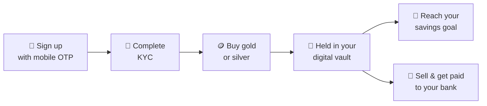

# AGS Gold

### Digital Gold & Silver, Made Simple.

**by Aurum Gold & Silvers**

Buy, save, and sell 24K digital gold and silver from your phone, starting at just ₹50.

 

 

[Features](#-features) · [How It Works](#-how-it-works) · [Savings Schemes](#-gold-savings-schemes) · [Refer & Earn](#-refer--earn) · [Security](#-security--trust) · [Admin Console](#-admin-console) · [Tech Stack](#-built-with)

 

---

## ✨ Features

<table>
<tr>
<td width="50%" valign="top">

### 📈 Live Gold & Silver Prices
Real-time 24K gold and silver rates with a full Tamil Nadu retail price breakdown. Interactive historical charts show how prices have moved over time.

</td>
<td width="50%" valign="top">

### 🪙 Buy in Seconds
Buy by **rupees** or by **grams**. One-tap quick-buy amounts: **₹50, ₹100, ₹250, ₹500, ₹1,000 and ₹2,000**. Pay with UPI, cards or netbanking through Razorpay.

</td>
</tr>
<tr>
<td width="50%" valign="top">

### 🏦 Sell Anytime
Sell your gold at the live buyback rate. The payout goes straight to your verified bank account once the sale is approved.

</td>
<td width="50%" valign="top">

### 🎯 Goal-Based Savings
Choose a **1 g, 5 g or 10 g** savings goal. Track your progress milestone by milestone, and upgrade your goal as you grow.

</td>
</tr>
<tr>
<td width="50%" valign="top">

### 💼 Your Portfolio
See your gold and silver holdings, how much you've invested, their current market value, and a complete history of every buy, sell and wallet transaction.

</td>
<td width="50%" valign="top">

### 🧾 Instant Tax Invoices
Every purchase comes with a professional PDF tax invoice, which can also be sent to your email.

</td>
</tr>
<tr>
<td width="50%" valign="top">

### 🪪 Quick KYC
Complete KYC inside the app with Aadhaar OTP verification and a PAN–Aadhaar link check.

</td>
<td width="50%" valign="top">

### 🏧 Bank Accounts
Add your bank account with automatic IFSC lookup for the bank and branch. Every new account is confirmed with an SMS OTP.

</td>
</tr>
<tr>
<td width="50%" valign="top">

### 🌐 English & தமிழ்
The whole app is available in **English** and **Tamil**, with light and dark themes.

</td>
<td width="50%" valign="top">

### 🔔 Smart Notifications
In-app alerts for purchases, sell requests, and stock coming back in. The app also updates itself when a new version is released.

</td>
</tr>
</table>

---

## 🔄 How It Works

---

## 🎯 Gold Savings Schemes

Pick a target and build towards it at your own pace.

| 🥉 Starter | 🥈 Growth | 🥇 Premium |
| :---: | :---: | :---: |
| **1 gram** | **5 grams** | **10 grams** |
| A small first step into gold | A steady savings habit | A serious gold reserve |

You can upgrade to a bigger scheme at any time. Your progress and milestones are shown right on the home screen.

---

## 🎁 Refer & Earn

Each savings scheme has its own referral code. When a friend joins with your code, their scheme is set automatically. You earn a cash reward in your wallet once they make their first qualifying purchase.

| Scheme | Your Reward | Friend's First Purchase |
| :---: | :---: | :---: |
| **1 g** | **₹150** | ₹100 or more |
| **5 g** | **₹350** | ₹1,000 or more |
| **10 g** | **₹550** | ₹2,000 or more |

Copy your code or share a link in one tap. Your referrals, earnings and wallet balance are all tracked in one place.

---

## 🛡️ Security & Trust

<table>
<tr>
<td align="center" width="25%">🔑 <b>OTP Login</b> Mobile-number sign-in with no passwords to remember</td>
<td align="center" width="25%">📲 <b>Device Binding</b> Your account is tied to your registered device</td>
<td align="center" width="25%">👆 <b>Biometric Lock</b> Fingerprint or face unlock on app launch</td>
<td align="center" width="25%">🧱 <b>Rooted-Device Protection</b> The app blocks compromised devices</td>
</tr>
<tr>
<td align="center" width="25%">🔒 <b>Encrypted KYC</b> Identity details are encrypted at rest</td>
<td align="center" width="25%">🛂 <b>Admin 2FA</b> Authenticator-app verification for admins</td>
<td align="center" width="25%">📜 <b>Full Audit Trail</b> Every admin action is recorded</td>
<td align="center" width="25%">🗑️ <b>Data Control</b> Request account and data deletion in the app</td>
</tr>
</table>

---

## 🧭 Admin Console

The same app includes a back-office console for the Aurum team. What each person sees depends on their role and permissions.

| Module | What it does |
| :--- | :--- |
| 📊 **Executive Dashboard** | Role-based KPIs and business overview for admins, managers and employees |
| 💸 **Sell Requests** | Review customer sell requests, then approve them with an automatic bank payout or reject them |
| 👛 **User Wallets** | Search customers, view their balances, and drill into complete transaction ledgers |
| 🧮 **Payment Settlements** | Reconcile online payments against Razorpay records |
| 🏛️ **Metal Inventory** | Manage gold and silver stock pools, restocks and reservations, with low-stock alerts |
| 📦 **Inventory & Suppliers** | Physical stock items, stock movements and supplier records |
| 👥 **Customers** | A complete customer directory with management tools |
| 🔁 **Workflows** | Approval workflows with escalation rules |
| 📑 **Reports** | Business analytics with export to CSV, Excel and PDF |
| 🕵️ **Audit Logs** | A searchable activity history with export |
| 🔐 **Users, Roles & Permissions** | Fine-grained access control for every team member |
| 🗂️ **Account Deletions** | Process customer data-deletion requests |
| 🏢 **Organization Profile** | Manage company details |

---

## 🧰 Built With

| Layer | Technology |
| :---: | :--- |
| **Mobile App** | Flutter · Riverpod · GoRouter |
| **Backend** | Python · FastAPI · SQLAlchemy (async) |
| **Database** | PostgreSQL |
| **Payments** | Razorpay (checkout) · RazorpayX (payouts) |
| **Identity** | Aadhaar OTP & PAN verification |
| **Messaging** | SMS OTP · transactional email |
| **Quality** | Automated unit, widget, integration, security & end-to-end test suites with CI on every change |

**Platforms:** Android · iOS · Web · Windows · macOS · Linux

---

**AGS Gold** · Aurum Gold & Silvers

© Aurum Gold & Silvers. All rights reserved.

