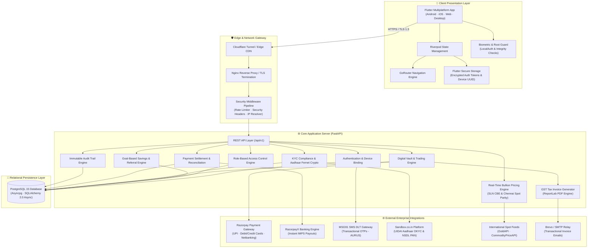
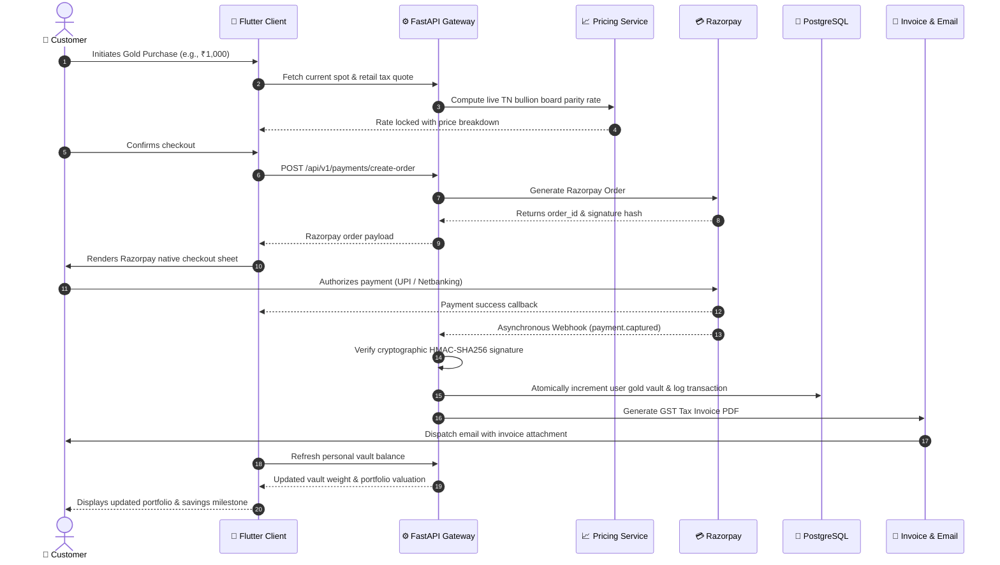

<div align="center">


# AGS Gold

### Sovereign 24K Digital Gold & Silver Asset Ecosystem

**An institutional-grade bullion trading, wealth accumulation, and back-office management platform by Aurum Gold & Silvers.**

<br />

[](#-technology-stack)
[](#-technology-stack)
[-009688?style=for-the-badge&logo=fastapi&logoColor=white)](#-technology-stack)
[](#-technology-stack)
[](#-technology-stack)
[](#-security-governance--compliance)

<br />

[Overview](#-executive-overview) &bull;
[Key Features](#-key-features) &bull;
[System Architecture](#-system-architecture) &bull;
[Application Flow](#-end-to-end-application-flow) &bull;
[Tech Stack](#-technology-stack) &bull;
[Project Structure](#-project-structure) &bull;
[Security & Compliance](#-security-governance--compliance) &bull;
[Status & Roadmap](#-project-status--roadmap)

</div>

<br />

---

## 🌟 Executive Overview

Gold has stood as humanity's most resilient store of value for millennia. Yet, modern consumers face steep barriers when purchasing physical bullion: prohibitive minimum ticket sizes, high jeweler making charges (8% to 25%), purity opacity, storage liabilities, and friction-filled buyback procedures.

**AGS Gold** solves these challenges by combining sovereign physical bullion reserves with high-speed digital fintech infrastructure. Developed for **Aurum Gold & Silvers**, the platform enables retail customers across India to buy, accumulate, and liquidate **24K 999.9 fine digital gold** and **999 pure silver** starting at just **₹50**. Every fractional unit purchased is backed by physical metal held in digital vault custody, fully documented with automated GST tax invoices, and immediately redeemable for cash payouts directly into verified bank accounts.

Alongside the customer experience, AGS Gold embeds a comprehensive **Enterprise Back-Office Suite** that empowers administrative, operations, and treasury teams with granular Role-Based Access Control (RBAC), live physical inventory tracking, Razorpay payment reconciliations, customer wallet ledgers, and tamper-evident audit logs.

<br />

---

## ✨ Key Features

### 🪙 Digital Bullion Trading & Vault Custody
- **Fractional Metal Accumulation**: Purchase 24K gold or 999 silver by rupee value (quick amounts: ₹50, ₹100, ₹250, ₹500, ₹1,000, ₹2,000) or by exact gram weight down to four decimal places.
- **Tamil Nadu Bullion Board Parity**: Live spot prices synchronized with international commodities (XAU/XAG) calibrated specifically to SLN Coimbatore 9999 and Chennai silver T+1 market parity.
- **Transparent Retail Cost Breakdown**: Real-time itemization of international spot pricing, import duties, Goods & Services Tax (3% GST), and local jeweler premium spreads.
- **Instant Digital Custody**: Purchases instantly credit the customer's secure digital vault with persistent, milligram-accurate balances.

### 🏦 Liquid Buyback & Automated Bank Payouts
- **24/7 Buyback Liquidity**: Customers can sell their accumulated gold or silver holdings at real-time buyback market rates.
- **Automated RazorpayX IMPS Settlement**: Approved sell inquiries execute automated direct-to-bank IMPS transfers into verified customer accounts without manual delays.
- **Sell Payout Audit Trail**: Full status tracking across pending review, processing, completion, or rejection with transparent transaction references.

### 🎯 Goal-Based Savings & Tiered Incentives
- **Structured Wealth Goals**: Flexible accumulation schemes designed for consistent savings habits:
  - 🥉 **Starter Tier (1 Gram)**: Micro-savings gateway designed for first-time precious metals investors.
  - 🥈 **Growth Tier (5 Grams)**: Disciplined accumulation framework for active families and savers.
  - 🥇 **Premium Tier (10 Grams)**: Substantial bullion reserve building with prioritized services.
- **Milestone Tracking**: Visual progress indicators tracking percentage completion toward target weights.
- **Scheme-Linked Referral Engine**: Each savings goal features dedicated referral codes. Referrers receive direct cash reward credits (₹150 for 1g, ₹350 for 5g, ₹550 for 10g) directly into their wallet upon qualifying first purchases.

### 🪪 Regulatory e-KYC & Banking Automation
- **Instant Aadhaar OKYC**: Seamless verification using Sandbox.co.in integration with UIDAI 6-digit OTP verification.
- **NSDL PAN Verification**: Automated validation of PAN card authenticity, name-matching algorithms, and active PAN–Aadhaar seeding checks.
- **Cryptographic PII Protection**: Sensitive Aadhaar credentials encrypted at rest with Fernet AES-128-CBC encryption.
- **Automated IFSC Discovery**: Live Razorpay IFSC integration automatically fetches bank names, branch addresses, and RTGS/NEFT/IMPS capabilities.
- **SMS OTP Bank Binding**: Every bank account linked for payouts requires mobile OTP confirmation for zero-trust fraud prevention.

### 🧾 Invoicing & Financial Transparency
- **Automated Tax Invoices**: Generates formal, corporate GST tax invoices in PDF format with HSN codes, SAC identifiers, and digital enterprise stamps.
- **Email Delivery Integration**: Invoices automatically dispatched to customer email addresses via transactional SMTP relay (Brevo).
- **Downloadable Financial Statements**: Comprehensive statement generation filtering buys, sells, referrals, and savings schemes.

### 🧭 Enterprise Administrative Console
- **Role-Based Access Control (RBAC)**: Distinct permissions partitioned across Super Admins, Administrators, Managers, and Operations Employees.
- **Executive Operations Dashboard**: Real-time KPI summaries covering bullion transaction volumes, active user growth, pending inquiries, and reserve health.
- **Digital & Physical Inventory Pool**: Track metal pool allocations, restock events, minimum reserve thresholds, and automated low-stock warnings.
- **Payment Settlement & Reconciliation**: Reconcile customer online payments against Razorpay settlement ledgers to catch and resolve drop-offs.
- **Admin Two-Factor Authentication**: Mandatory TOTP authentication (compatible with Google Authenticator and Authy) for sensitive administrative actions.
- **Tamper-Evident Audit Logging**: Every staff mutation, role assignment, and inventory movement is permanently logged with IP address, user agent, actor ID, and metadata.

### 🌐 Localization & Inclusive Design
- **Bilingual Interface**: Comprehensive native localization in both **English** and **Tamil (தமிழ்)** across all consumer and administrative views.
- **Luxury Aesthetic Theming**: Handcrafted warm cream and gold light theme alongside an obsidian slate dark theme optimized for readability.
- **Responsive Layout Engine**: Adaptive design delivering native ergonomics on mobile smartphones, tablets, and desktop web browsers.

<br />

---

## 🏗️ System Architecture

AGS Gold is architected as an asynchronous, layered, decoupled ecosystem designed for enterprise reliability, high-concurrency pricing streams, and zero-trust transaction safety.



<br />

---

## 🔁 End-to-End Application Flow

The lifecycle of a digital gold transaction demonstrates how client interactions traverse security, financial, and persistence boundaries:



<br />

---

## 🧰 Technology Stack

| Layer | Technology | Version / Specification | Architectural Purpose |
| :--- | :--- | :--- | :--- |
| **Mobile & Web Client** | **Flutter** | SDK 3.x / Dart 3 | Cross-platform client for Android, iOS, and Web |
| **State Management** | **Flutter Riverpod** | v3.3.1 | Declarative, compile-safe dependency injection and state |
| **Client Routing** | **GoRouter** | v17.3.0 | Declarative URL-driven navigation and audience redirection |
| **Network Client** | **Dio** | v5.9.2 | Resilient HTTP transport with automatic token interceptors |
| **Secure Key Storage** | **Flutter Secure Storage** | v10.3.1 | Hardware-backed keystore/keychain for tokens and device ID |
| **Client Biometrics** | **LocalAuth** | v3.0.2 | Native fingerprint and facial biometric app authentication |
| **Backend API Engine** | **FastAPI** | v0.110+ | High-throughput asynchronous REST API framework |
| **ASGI Web Server** | **Uvicorn** | Standard 0.28+ | High-performance asynchronous server implementation |
| **Data Validation** | **Pydantic v2** | v2.6+ | Strict type validation, serialization, and settings parsing |
| **Database ORM** | **SQLAlchemy** | v2.0+ (Asyncio) | Asynchronous object-relational mapping and connection pooling |
| **Database Driver** | **Asyncpg** | v0.29+ | High-performance PostgreSQL asynchronous binary driver |
| **Database Migrations** | **Alembic** | v1.13+ | Automated, version-controlled schema evolution |
| **Database Engine** | **PostgreSQL** | v15 (Alpine) | ACID-compliant relational data store with row-level locks |
| **Payment Gateway** | **Razorpay** | Standard Checkout | Customer purchase processing across UPI, cards, netbanking |
| **Banking Payouts** | **RazorpayX** | Direct IMPS API | Automated instant customer sell payouts directly to bank |
| **Identity & Compliance**| **Sandbox.co.in** | OKYC & PAN v1.0 | UIDAI Aadhaar OTP validation and NSDL PAN verification |
| **Cryptography** | **Fernet (Cryptography)**| AES-128-CBC / SHA256 | Symmetric encryption for Aadhaar numbers and secrets at rest |
| **SMS Communications** | **MSG91 DLT** | Flow & SendOTP | Transactional authentication OTPs with registered DLT sender |
| **Email Relay** | **Brevo (Sendinblue)** | Transactional SMTP | Automated dispatch of GST invoices and security alerts |
| **Commodity Feeds** | **GoldAPI / CommodityAPI**| Live Spot APIs | International gold (XAU) and silver (XAG) market spot rates |
| **PDF Generation** | **ReportLab** | v4.1+ | Mathematical layout engine for corporate GST tax invoices |
| **Containerization** | **Docker & Docker Compose**| Multi-stage runner | Containerized production deployment for backend and database |

<br />

---

## 📁 Project Structure

```
Aura-gold-minic/
├── backend/
│   ├── alembic/                      # Database schema migration scripts and versions
│   ├── app/
│   │   ├── api/                      # REST API endpoint route controllers (/api/v1)
│   │   │   ├── auth.py               # Mobile OTP authentication & token lifecycle
│   │   │   ├── payments.py           # Razorpay order creation and purchase workflows
│   │   │   ├── dashboard.py          # Customer portfolio metrics and live bullion prices
│   │   │   ├── profile.py            # User profile, settings, and Aadhaar/PAN KYC endpoints
│   │   │   ├── admin_wallet.py       # Back-office customer wallet ledgers and transactions
│   │   │   ├── admin_digital_inventory.py # Digital bullion reserve pool management
│   │   │   ├── admin_2fa.py          # TOTP two-factor authentication for administrators
│   │   │   └── razorpay_webhooks.py  # Asynchronous payment capture and refund webhooks
│   │   ├── core/                     # Foundational security, crypto, and config primitives
│   │   │   ├── config.py             # Pydantic environment configurations and constants
│   │   │   ├── security.py           # JWT token generation, bcrypt password hashing
│   │   │   ├── kyc_crypto.py         # Fernet symmetric encryption for Aadhaar at rest
│   │   │   └── client_ip.py          # Trusted proxy and Cloudflare client IP resolution
│   │   ├── database/                 # Async database engine, session makers, and base models
│   │   ├── middleware/               # Security headers, rate limiting, and audit logging
│   │   ├── models/                   # SQLAlchemy ORM domain entities and relationships
│   │   ├── repositories/             # Data access layer isolating SQL queries from services
│   │   ├── schemas/                  # Pydantic request, response, and DTO data schemas
│   │   ├── services/                 # Core business logic domain services
│   │   │   ├── metal_prices.py       # Live pricing engine and Tamil Nadu parity calculations
│   │   │   ├── gold_payment.py       # Razorpay purchase orchestration and digital minting
│   │   │   ├── sell_payout.py        # Customer sell orders and RazorpayX IMPS payout engine
│   │   │   ├── sandbox_kyc.py        # Sandbox.co.in Aadhaar OKYC and PAN link service
│   │   │   ├── gold_scheme.py        # Goal-based savings schemes (1g, 5g, 10g)
│   │   │   ├── invoice.py            # ReportLab corporate GST tax invoice generator
│   │   │   ├── sms.py                # MSG91 DLT transactional SMS dispatch
│   │   │   └── audit.py              # Tamper-evident administrative audit logger
│   │   └── main.py                   # FastAPI application initialization and routing
│   ├── tests/                        # Comprehensive unit, service, and security test suites
│   ├── docker-compose.yml            # Multi-container orchestration (FastAPI + PostgreSQL)
│   └── Dockerfile                    # Multi-stage container build specification
│
├── frontend/
│   ├── assets/                       # Brand icons, logo graphics, and visual assets
│   ├── lib/
│   │   ├── config/                   # Dynamic environment configurations (Dev / Prod URLs)
│   │   ├── core/                     # Shared UI components, theme tokens, and security guards
│   │   │   ├── theme/                # Luxury cream/gold and dark mode design specifications
│   │   │   ├── widgets/              # Biometric guard, root detector, KYC gates, data tables
│   │   │   └── responsive/           # Adaptive layout builders for mobile and desktop screens
│   │   ├── features/                 # Modular domain features following clean architecture
│   │   │   ├── auth/                 # Mobile OTP login, role selector, and device binding
│   │   │   ├── user_dashboard/       # Customer live prices, buy/sell gold, and portfolio
│   │   │   ├── admin/                # Executive dashboard, customer wallets, settlements
│   │   │   ├── referral/             # Scheme-linked referral link and earnings screen
│   │   │   └── notifications/        # In-app transactional alerts and app update notices
│   │   ├── l10n/                     # Internationalization files for English and Tamil (தமிழ்)
│   │   ├── routes/                   # GoRouter navigation graph with audience-based guards
│   │   └── services/                 # Dio HTTP transport, secure storage, and Riverpod providers
│   └── pubspec.yaml                  # Flutter package dependencies and platform declarations
│
└── docs/                             # Architecture diagrams, specifications, and project assets
```

<br />

---

## 🔒 Security, Governance & Compliance

AGS Gold is engineered in adherence to fintech security standards and regulatory mandates:

```
┌───────────────────────────────────────────────────────────────────────────┐
│                      DEFENSE-IN-DEPTH SECURITY MODEL                      │
├──────────────────────────┬────────────────────────────────────────────────┤
│ 🔐 Device Binding        │ User accounts are cryptographically bound to   │
│                          │ hardware device UUIDs to prevent session theft.│
├──────────────────────────┼────────────────────────────────────────────────┤
│ 👆 Biometric Gate        │ Native Touch ID, Face ID, or fingerprint lock  │
│                          │ prompts upon application launch and resume.    │
├──────────────────────────┼────────────────────────────────────────────────┤
│ 🛡️ Root Detection        │ SecurityGuard prevents execution on rooted or  │
│                          │ compromised mobile environments.               │
├──────────────────────────┼────────────────────────────────────────────────┤
│ 🔒 Aadhaar Encryption    │ 12-digit Aadhaar numbers are Fernet-encrypted  │
│                          │ at rest using AES-128-CBC with HMAC-SHA256.    │
├──────────────────────────┼────────────────────────────────────────────────┤
│ 🛂 Admin Multi-Factor    │ Mandatory TOTP 2FA via pyotp (Google Auth /    │
│                          │ Authy) required for all back-office mutations. │
├──────────────────────────┼────────────────────────────────────────────────┤
│ 📜 Immutable Audit Logs  │ Every administrative operation records actor,  │
│                          │ client IP, timestamp, action, and JSON diff.   │
├──────────────────────────┼────────────────────────────────────────────────┤
│ 🛑 Rate Limiting         │ Token-bucket rate limiting across login, OTP   │
│                          │ requests, and sensitive transaction endpoints. │
├──────────────────────────┼────────────────────────────────────────────────┤
│ 🗑️ Data Privacy (GDPR)  │ Self-service account and personal data deletion│
│                          │ request workflow with audit review pipelines.  │
└──────────────────────────┴────────────────────────────────────────────────┘
```

<br />

---

## 📊 Project Status & Roadmap

### ✅ Production-Ready & Deployed Features
- [x] Live bullion pricing engine with international spot synchronization and Tamil Nadu retail tax calculation.
- [x] Fractional 24K gold and 999 silver purchase via Razorpay (UPI, Netbanking, Cards).
- [x] Automated Razorpay webhook handling with HMAC signature validation and idempotent vault allocation.
- [x] Liquid sell buyback inquiries with automated instant IMPS payouts via RazorpayX.
- [x] Goal-based savings schemes (1g, 5g, 10g) with milestone tracking and tiered upgrades.
- [x] Scheme-linked referral reward system with wallet credits.
- [x] Instant UIDAI Aadhaar OKYC and NSDL PAN verification via Sandbox.co.in.
- [x] Bank account verification with automated IFSC lookup and SMS OTP binding.
- [x] Automated ReportLab PDF GST Tax Invoice generation and Brevo email delivery.
- [x] Back-office executive console with role-based access control (RBAC) and audit trails.
- [x] Admin Two-Factor Authentication (TOTP via Google Authenticator / Authy).
- [x] Complete bilingual localization in English and Tamil (தமிழ்).
- [x] Device binding, biometric lock, and root detection security guards.

### 🔮 Forward Roadmap
- [ ] Physical bullion home delivery with doorstep insured vault logistics.
- [ ] Automated Recurring SIP (Systematic Investment Plan) via UPI e-Mandate / eNACH.
- [ ] Digital Gold Gifting module with personalized celebratory greeting cards.
- [ ] Jeweler partner store redemption network across South India.

<br />

---

<div align="center">


### AGS Gold &bull; Aurum Gold & Silvers

*Redefining Precious Metals Investment Through Technology and Trust.*

<sub>&copy; Aurum Gold & Silvers. All rights reserved. Intellectual Property and Proprietary Software.</sub>

</div>
